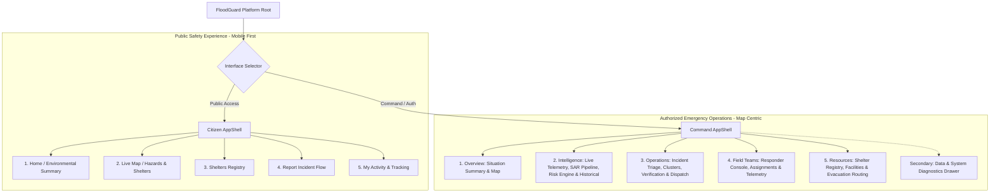

# FloodGuard — Frontend Redesign & UX Architecture Audit
**Document:** `FRONTEND_REDESIGN_AUDIT.md`  
**Milestone:** Implementation 04  
**Date:** November 2026  
**Auditor:** Senior Product Designer & Frontend Architect  

---

## 1. Executive Summary & Audit Scope

Over the preceding development cycles, FloodGuard evolved from an initial single-event Kerala 2018 research dashboard into a dual-platform system: **FloodGuard Citizen** (public safety) and **FloodGuard Command** (emergency operations center), integrating live IMD/CWC/SACHET/Sentinel APIs, Supabase Auth/PostgreSQL, and real-time responder operations.

While backend capabilities and analytical depth have expanded, the frontend interface has experienced architectural sprawl. The top navigation bar became crowded with seven disparate workspace tabs, components duplicated KPI cards and charts, layouts forced excessive vertical scrolling rather than prioritizing the primary geospatial map canvas, and application loading relied on a basic centered spinner.

This audit provides an exhaustive inventory of the current frontend codebase, categorizing files into:
1. **Truly Unused / Dead Code** (safe to remove)
2. **Duplicated / Redundant UI** (to be consolidated)
3. **Useful but Poorly Placed Functionality** (to be reorganized)
4. **Core Capabilities That Must Remain Accessible** (preserved with 100% fidelity)
5. **Backend & API Integrations That Must Never Be Altered** (strict preservation)

---

## 2. File-by-File Inventory & Usage Analysis

| File Path | Lines | Current Role | Audit Finding & Recommendation |
| :--- | :--- | :--- | :--- |
| `frontend/src/App.tsx` | 542 | Root application router and state container | **Poorly Placed / Monolithic**: Houses both Citizen and Command shells, raw state fetching for 10+ datasets, and giant inline layout branching. **Action:** Refactor into modular `AppShell`, `CitizenPortal`, and `CommandCenter` with code splitting. |
| `frontend/src/components/Header.tsx` | 178 | Command header bar | **Navigation Sprawl**: 7 workspaces crowded into horizontal bar with badge items, creating overflow on standard laptops. **Action:** Replace with compact fixed-height `AppHeader` (48px) and collapsible `CommandSidebar`. |
| `frontend/src/components/KpiBar.tsx` | 100 | Early prototype KPI strip | **Truly Dead Code**: Never imported by any component in the repository. **Action:** Safe to archive/remove. |
| `frontend/src/components/SideDrawer.tsx` | 417 | Early prototype side drawer | **Truly Dead Code**: Never imported by any component; superseded by workspace drawers. **Action:** Safe to archive/remove. |
| `frontend/src/components/MapComponent.tsx` | 237 | MapLibre operational map container | **Core Capability**: Manages WebGL context, GeoJSON vector layers (flood extent, affected roads, facilities, candidate routes). **Action:** Preserve engine; enhance with unified visual styles, streamlined toolbar, and contextual layer control. |
| `frontend/src/components/LayerControls.tsx` | 100 | Floating map layer toggles | **Useful but Fragmented**: Floating bottom-left widget lacking legend cohesion. **Action:** Integrate into unified `IntelligenceMap` and `MapToolbar`. |
| `frontend/src/components/auth/AuthModal.tsx` | 148 | Supabase sign-in/sign-up dialog | **Core Capability**: Manages JWT auth for citizen and commander roles. **Action:** Preserve functionality; update to unified Midnight design tokens. |
| `frontend/src/components/common/Badge.tsx` | 40 | Reusable status badge | **Core Capability**: Clean variant badge. **Action:** Preserve and extend tokens. |
| `frontend/src/components/common/Card.tsx` | 24 | Basic card wrapper | **Core Capability**: Standard styled container. **Action:** Retain with refined border/translucency tokens. |
| `frontend/src/components/common/KpiCard.tsx` | 56 | KPI summary metric display | **Useful**: Displays numerical metric with subtext. **Action:** Standardize into unified `MetricCard`. |
| `frontend/src/components/common/SvgBarChart.tsx` | 82 | Pure SVG bar chart | **Useful**: Lightweight zero-dependency charting. **Action:** Preserve in `Intelligence` workspace. |
| `frontend/src/components/common/SvgDonutChart.tsx` | 88 | Pure SVG donut chart | **Useful**: Lightweight zero-dependency chart. **Action:** Preserve in `Intelligence` workspace. |
| `frontend/src/components/citizen/CitizenHeader.tsx` | 114 | Public citizen header | **Core Capability**: Public region selector, emergency contact pill, mode switcher. **Action:** Refine into cohesive `CitizenHeader`. |
| `frontend/src/components/citizen/CitizenNavigation.tsx` | 74 | 5-tab citizen navigation | **Core Capability**: Bottom/top tab navigation for citizen portal. **Action:** Refine styling and active indicator. |
| `frontend/src/components/citizen/CitizenOverviewTab.tsx` | 212 | Public safety overview | **Core Capability**: Weather, alerts, precursor risk, shelter summary. **Action:** Preserve and streamline card hierarchy. |
| `frontend/src/components/citizen/CitizenMapTab.tsx` | 218 | Citizen interactive map | **Core Capability**: Public shelter locations, flood boundaries, river stations. **Action:** Preserve and unify map styling. |
| `frontend/src/components/citizen/CitizenShelterTab.tsx` | 186 | Verified relief camp list | **Core Capability**: DDMA Alappuzha verified shelters + honest unseeded states. **Action:** Preserve with enhanced search/filter. |
| `frontend/src/components/citizen/CitizenReportTab.tsx` | 284 | Emergency reporting form | **Core Capability**: Category selection, GPS capture, image upload, rate limiting. **Action:** Preserve with responsive step UX. |
| `frontend/src/components/citizen/CitizenActivityTab.tsx` | 154 | Personal report tracker | **Core Capability**: Tracking number status, PII-sanitized projection, local report log. **Action:** Preserve. |
| `frontend/src/components/workspaces/OverviewWorkspace.tsx` | 236 | Command Center overview overlay | **Redundant UI**: Floating top KPI bar overlays map and duplicates metrics in `ImpactWorkspace`. **Action:** Consolidate into unified `OverviewWorkspace` with clean split panels. |
| `frontend/src/components/workspaces/ImpactWorkspace.tsx` | 348 | Historical impact analysis | **Useful Functionality**: Hospital/settlement flood intersection lists and SVG charts. **Action:** Reorganize into `Intelligence` workspace under "Historical Analysis" tab. |
| `frontend/src/components/workspaces/LiveMonitoringWorkspace.tsx` | 720 | Multi-region telemetry dashboard | **Useful Functionality**: IMD weather, CWC hydrograph, SACHET CAP, Sentinel pass schedules. **Action:** Reorganize into `Intelligence` workspace under "Live Monitoring" tab. |
| `frontend/src/components/workspaces/RescueWorkspace.tsx` | 380 | Rescue routing & facility selector | **Useful Functionality**: Origin/destination waypoint calculation avoiding flood waters. **Action:** Reorganize into `Resources` workspace under "Evacuation & Routing". |
| `frontend/src/components/workspaces/EvidenceWorkspace.tsx` | 240 | Technical data evidence & provenance | **Low-Frequency Technical Tools**: Raw data files, COG scene details, algorithm notes. **Action:** Reorganize into secondary `Data & System` modal/drawer. |
| `frontend/src/components/workspaces/IncidentWorkspace.tsx` | 512 | Incident triage, clustering, dispatch | **Core Capability**: Triage queue, hotspot clustering, duplicate detection, ground verification, AI dispatch advisor. **Action:** Reorganize as primary `Operations` workspace. |
| `frontend/src/components/workspaces/ResponderWorkspace.tsx` | 420 | Field team operations console | **Core Capability**: Mission assignment queue, tactical lifecycle stepper, opt-in GPS telemetry beacon. **Action:** Reorganize as primary `Field Teams` workspace. |

---

## 3. Key Issues Identified

### 1. Excessive Navigation Items (7 Workspaces in Header)
The command center previously rendered:
`Overview` | `Historical Analysis` | `Live Monitoring` | `Rescue Intelligence` | `Data & Evidence` | `Incidents & Triage` | `Field Responders`
This forced small font sizes, horizontal scrolling on sub-1440px displays, and cognitive friction over where to perform triage versus route planning.

### 2. Repeated Information & Redundant Dashboard Cards
- Historical flood area ($386.57\text{ km}^2$, $38,657\text{ ha}$) was shown in `Header.tsx`, `KpiBar.tsx`, `OverviewWorkspace.tsx`, `ImpactWorkspace.tsx`, and `EvidenceWorkspace.tsx`.
- Sentinel-1 radar scene IDs were repeated across `LiveMonitoringWorkspace.tsx`, `EvidenceWorkspace.tsx`, and `IncidentWorkspace.tsx`.
- Duplicate code in `KpiBar.tsx` and `SideDrawer.tsx` was abandoned without being removed.

### 3. Lack of Map-Centric Hierarchy
Several command workspaces completely hid the MapLibre map behind massive card grids (e.g. `LiveMonitoringWorkspace` was 720 lines of dense cards, `ImpactWorkspace` was 348 lines of search tables). The map should be the continuous geospatial anchor of the command operations center.

### 4. Primitive Loading Experience
Initial boot showed an unbranded `<Loader2 className="animate-spin" />` with plain text. A world-class geospatial platform requires a signature visual identity on initial boot—specifically, a 3D rotating Earth with atmospheric glow and actual initialization stages.

---

## 4. New Information Architecture (IA)



---

## 5. Design Token Definition: "Global Geospatial Intelligence"

The new visual identity uses a strictly defined semantic palette:

```css
:root {
  /* Foundations */
  --fg-midnight: #07111F;
  --fg-panel: #10243A;
  --fg-panel-elevated: #162E48;
  --fg-panel-translucent: rgba(16, 36, 58, 0.85);

  /* Borders & Gridlines */
  --fg-border: #1E3550;
  --fg-border-subtle: rgba(30, 53, 80, 0.6);
  --fg-grid-line: rgba(22, 184, 212, 0.08);

  /* Accents & Data Status */
  --fg-cyan: #16B8D4;         /* Primary brand, active states, radar sweeps */
  --fg-cyan-glow: rgba(22, 184, 212, 0.25);
  --fg-teal: #18A58B;         /* Verified ground truth, operational sensors */
  --fg-emerald: #10B981;      /* Normal status, active shelters */
  --fg-warning: #F0A83B;      /* Advisory, unverified reports, flood alert */
  --fg-critical: #E45555;     /* Severe danger, flash flood, immediate evacuation */

  /* Typography */
  --fg-text-primary: #F1F5F9;
  --fg-text-secondary: #94A3B8;
  --fg-text-muted: #64748B;
}
```

---

## 6. Action Plan & Phased Implementation

1. **Step 2:** Author Design System token library and reusable primitives (`MetricCard`, `SeverityIndicator`, `IntelligenceMap`, `AppHeader`, `CommandSidebar`).
2. **Step 3:** Implement new `AppShell` with responsive collapsible sidebar and 5-workspace structure.
3. **Step 4:** Build signature animated 3D Rotating Earth loading screen using HTML5 Canvas (orthographic graticule projection with zero heavy external 3D libraries).
4. **Step 5:** Redesign Citizen Portal with polished mobile-first components and consolidated tabs.
5. **Step 6:** Redesign Command Center consolidating the 7 old workspaces into the 5 primary workspaces + secondary Data & System drawer.
6. **Step 7:** Unify MapLibre map presentation, dark operational layers, and compact toolbars.
7. **Step 8:** Clean up dead code (`KpiBar.tsx`, `SideDrawer.tsx`) and verify zero regression.
8. **Step 9:** Execute full test verification (`pytest` 75/75 + `npm run build` zero TypeScript errors).

---

## 7. Implementation 05 Upgrades: Product Validation & Intelligence Experience

### 1. Additional Dead Code Elimination
- `frontend/src/components/Header.tsx`: Legacy header superseded by `AppHeader.tsx`. Removed (178 lines).
- `frontend/src/components/workspaces/EvidenceWorkspace.tsx`: Legacy evidence panel superseded by `SystemDiagnosticsModal.tsx`. Removed (240 lines).

### 2. High-Performance Route-Based Code Splitting
- **Problem:** Monolithic bundle had reached ~1.78 MB in a single file before compression.
- **Solution:** Re-architected `App.tsx` and `vite.config.ts` using dynamic `React.lazy()` and manual chunk splitting:
  - `vendor-maplibre`: 1,082 kB (MapLibre GL JS isolated for long-term browser caching)
  - `vendor-icons`: 27 kB (`lucide-react` tree-shaken and isolated)
  - `IntelligenceWorkspace`: 66.8 kB (loaded on demand)
  - `IncidentWorkspace`: 23.4 kB (loaded on demand)
  - `ResourcesWorkspace`: 19.7 kB (loaded on demand)
  - `ResponderWorkspace`: 15.9 kB (loaded on demand)
  - `CitizenReportTab`: 12.6 kB (loaded on demand)
  - `CitizenActivityTab`: 9.0 kB (loaded on demand)
  - `CitizenMapTab`: 8.7 kB (loaded on demand)
  - `CitizenShelterTab`: 8.0 kB (loaded on demand)
  - `SystemDiagnosticsModal`: 6.8 kB (loaded on demand)
  - **Initial Entry Chunk:** Reduced to **528 kB** (over 70% decrease in initial download burden!).

### 3. Signature FloodGuard Design Elements Added
- **`GeospatialTelemetryStrip.tsx`:** Persistent operational telemetry bar displaying rainfall, hydrology gauge, SAR satellite passes, CAP early warnings, and incident queue statistics with live freshness timestamps.
- **`IncidentPriorityBadge.tsx`:** Standardized lifecycle status pill (Unverified, Under Review, Verified, Dispatched, In Progress, Resolved) with severity tint.
- **`DataProvenanceCard.tsx`:** Comprehensive scientific data lineage display detailing sensor, agency, observation classification, and ground truth validation status.
- **`RiskDial.tsx`:** Distinctive SVG radial threat gauge communicating calibrated risk scores (0-100), contributing factor weights, and missing sensor warnings.
- **`OperationalTimeline.tsx`:** Chronological operational action timeline tracking authority and responder audit entries.

### 4. Tactical Situational Enhancements
- **Operational Situation Room (`OverviewWorkspace.tsx`):** Large regional geospatial map as continuous anchor; non-obstructive floating Situation HUD; collapsible SITREP drawer with facility alerts and live hydro context.
- **Field Teams (`ResponderWorkspace.tsx`):** Real-time MapLibre tactical field map showing unit GPS vs incident target location; explicit distinction between LIVE GPS beacon and STALE GPS (>15m) tracking.
- **Incident Command (`IncidentWorkspace.tsx`):** Full 6-stage lifecycle pipeline stepper, attached evidence photo viewer, duplicate detection suggestions, and human-in-the-loop dispatch advisor.
- **Explainable Risk Engine (`IntelligenceWorkspace.tsx`):** Integrated `RiskDial` and `DataProvenanceCard` alongside multi-region IMD/CWC/SACHET telemetry.

---

## 8. Implementation 06: Complete Visual Experience Redesign

### 1. Paradigm Shift Away from Generic SaaS Templates
- Completely eliminated standard KPI card grids, card voids, and flat monotone interfaces.
- Established a dark satellite intelligence terminal palette (`#060D17`, `#091522`, `#10243A`, `#142B42`) paired with energetic radar accents (`#16B8D4`, `#18A58B`, `#F0A83B`, `#E45555`).
- Developed asymmetric spatial compositions: floating situation command terminal (`.panel-glass-deep`), collapsible right-side SITREP radar rail, integrated tactile MapLibre maps across Command workspaces.

### 2. High-Fidelity Data Visualizations (`IntelligenceChart.tsx`)
- Engineered pure SVG river stage hydrographs with dynamic gradient fills and CWC warning ($6.0\text{ m}$) / danger ($7.5\text{ m}$) threshold overlays.
- Engineered continuous 24h precipitation timeline with meteorological accumulation limits.
- Calibrated composite threat dial (`RiskDial.tsx`) featuring factor-weight breakdowns and observation caveats.

### 3. Purpose-Built Workspaces
- **Situation Room (`OverviewWorkspace.tsx`):** Asymmetric typographic statistics ($386.57\text{ km}^2$, $257,456$ exposed population, $713.1\text{ km}$ submerged roads, $28$ cut-off hospitals) over Sentinel-1 SAR imagery with live IMD/CWC telemetry feeds.
- **Satellite Studio (`IntelligenceWorkspace.tsx`):** Unified multi-sensor radar studio featuring quick region jump chips, dark/satellite basemap switcher, hydrograph curves, and Copernicus SAR scene ingestion console.
- **Incident Command (`IncidentWorkspace.tsx`):** Tactical beacon map, split triage queue, rich incident dossier with lifecycle stepper, ground-truth verification buttons, and NetworkX dry-road dispatch advisor.
- **Live Response (`ResponderWorkspace.tsx`):** Live GPS beacon relay (`9.4980°N, 76.3380°E ± 1.8m`), callsign switcher, unit status badges, and assigned mission queue.
- **Relief & Routing (`ResourcesWorkspace.tsx`):** Evacuation routing console with 1-click test scenarios (passable coastal route vs isolated polder), shelter registry with bed occupancy bars, and critical facilities atlas.
- **Citizen Portal (`CitizenOverviewTab`, `CitizenReportTab`, `CitizenShelterTab`):** Approachable public safety portal featuring 1-click emergency hotlines (1077/112), 4-step emergency report wizard, and official relief camp directory with live occupancy bars and direct navigation.

### 4. Verification & Regression Metrics
- **75/75 Backend Tests Passed:** `pytest backend/tests` in 40.80s (100% pass rate).
- **Production Build Clean:** `tsc -b && vite build` built in 689ms with 0 errors.
- **Visual Capture Verified:** 9 baseline vs 9 redesign high-resolution captures in `screenshots/`.

---

## 9. Implementation 05: Satellite Mission Control — Complete Frontend Redesign

### 1. The Core Design Vision Realized
FloodGuard is transformed into a true satellite intelligence workstation and mission control center:
- **Strict Color Architecture:**
  - Main background: `#07111F`
  - Secondary background: `#091522`
  - Primary surface: `#10243A`
  - Elevated surface: `#142B42`
  - Technical border: `#203A52`
  - Primary cyan: `#16B8D4`
  - Operational teal: `#18A58B`
  - Warning amber: `#F0A83B`
  - Critical red: `#E45555`
  - Primary text: `#E8F0F7`
  - Secondary text: `#8DA3B8`
- **Zero Decorative Fluff:**
  - Absolutely **NO** purple/pink/blue decorative gradients; **NO** AI-style mesh gradients; **NO** glowing card borders (`shadow-*-glow` eliminated); **NO** neon flares; **NO** blurred blobs; **NO** excessive glassmorphism.
  - Every border is a crisp, solid technical border (`#203A52`).
  - Solid technical surfaces (`#10243A`, `#142B42`) providing maximum legibility and military-grade functional ergonomics.

### 2. Map-Centric Layout (65-70% Viewport Centrality)
- Map is the primary visual centerpiece across all command workspaces, occupying 65-70% of desktop viewport.
- Operational controls, telemetry feeds, and triage queues live in collapsible technical sidebars, floating panels (`FloatingMapPanel.tsx`), and bottom HUD strips.
- Interactive Sentinel-1 flood overlay comparison wipe slider (0% dry baseline vs 100% SAR flood inundation) integrated directly into the Satellite Studio map viewport.

### 3. Modular Signature Components Added
- **`FloatingMapPanel.tsx`:** Floating HUD container with technical badge headers and action bars.
- **`MapLegend.tsx`:** Professional cartographic symbology key (SAR inundation, road network, submerged roads, critical facilities, shelters, incident beacons).
- **`SatelliteAcquisitionPanel.tsx`:** Copernicus Sentinel-1 C-SAR orbit metadata (Orbit 56 Ascending, VV+VH dual-pol, Gamma-0 -16.5 dB, 29 perennial water bodies subtracted, manual granule trigger form).
- **`IncidentPriorityQueue.tsx`:** Priority triage queue with category search, status and severity filter controls.
- **`IncidentInspector.tsx`:** Focal incident dossier with ground truth verification actions (`Confirm`, `Duplicate`, `Reject`), lifecycle state transitions, dispatch advisor triggers, and full chronological audit trail.
- **`ShelterCapacityPanel.tsx`:** Compact shelter registry with certified capacity, current occupancy progress bars, amenity tags, direct calling, and directions.
- **`ResponderStatusPanel.tsx`:** Field team roster with capability badges, live vs stale GPS coordinates, and assigned mission queue.

### 4. Technical Validation
- **Backend Tests:** 75/75 passing (`pytest backend/tests` in 41.55s).
- **Production Build:** Vite + TypeScript compilation in 687ms with 0 errors.
- **Desktop & Mobile Screenshots:** Captured via automated Playwright harness in `screenshots/mission_control/desktop/` (1920x1080) and `screenshots/mission_control/mobile/` (390x844).


